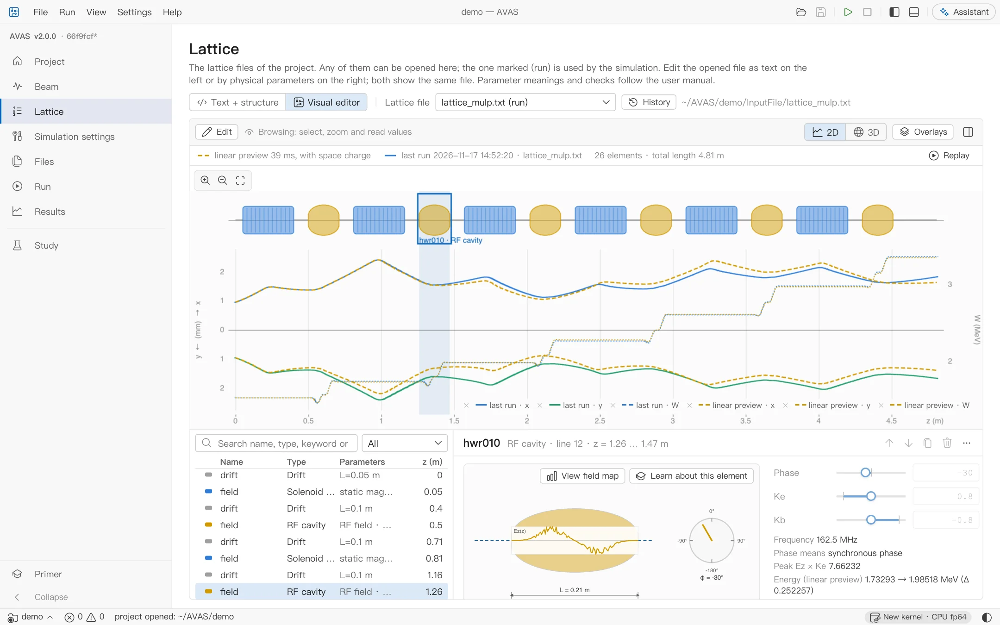
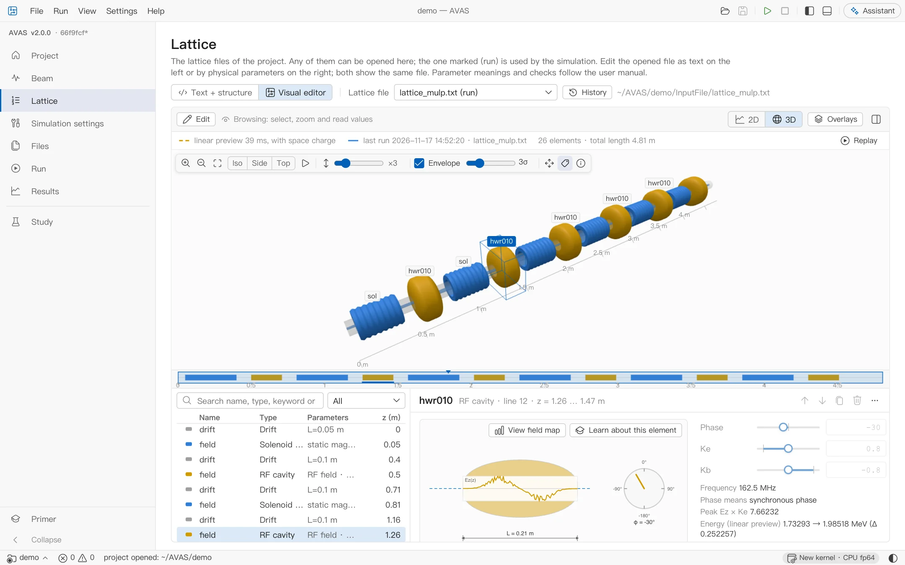
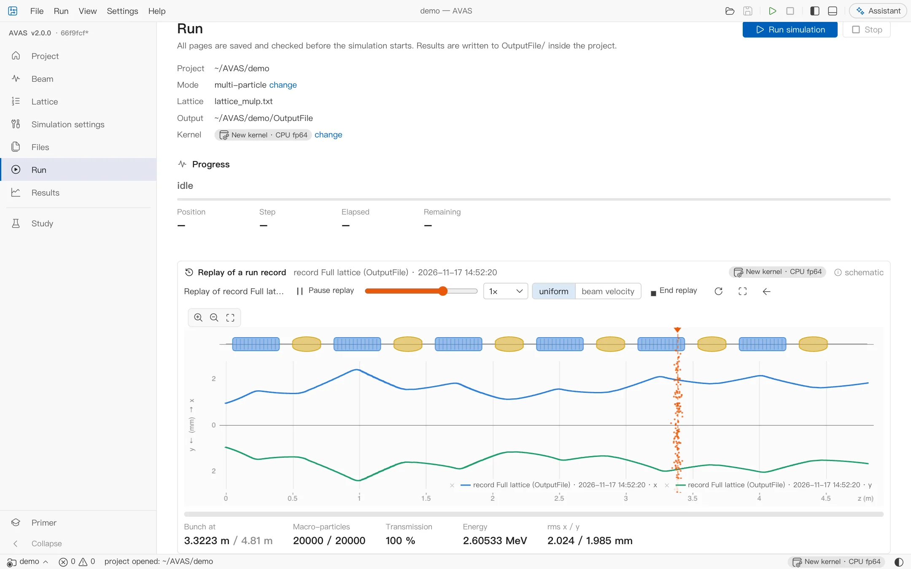
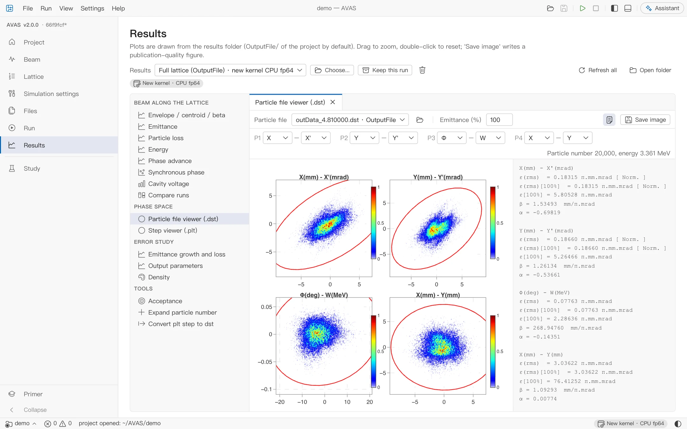
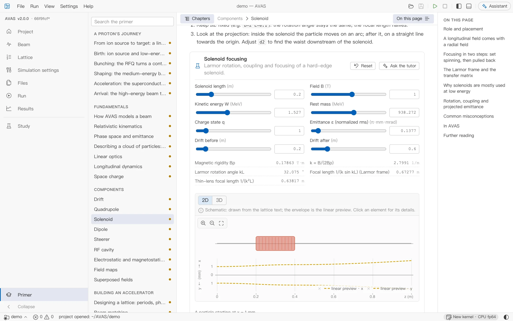

<div align="center">


# AVAS

**Advanced Virtual Accelerator Software: beam dynamics simulation for linear accelerators**

[](https://github.com/lycself/AVAS_XMU/releases/latest)
[](https://github.com/lycself/AVAS_XMU/actions/workflows/ci.yml)


[-b31b1b)](https://doi.org/10.1103/PhysRevAccelBeams.28.044602)

[中文](README.md) · English

</div>

AVAS simulates multi-particle beams in linear accelerators: field-map elements such as RF cavities and solenoids, hard-edge elements such as quadrupoles and dipoles, three space-charge solvers, error studies and loss boundaries. It comes with a desktop and browser interface, a command line and a Python research interface; the interface is available in English and Chinese.

<p align="center"></p>

- **One kernel, three kinds of device**: the rebuilt new kernel computes on the CPU, NVIDIA GPUs (CUDA) and the Mac GPU (Metal), and a GPU needs only its driver; the mode “Reproduce AVAS.dll” gives the original kernel's results bit for bit.
- **Visual beamline editing**: text, structure table, 2D layout and 3D view share one lattice and one undo history, with a live linear envelope preview while you change parameters.
- **Runs and analysis**: live envelopes and replay, phase-space viewer, run comparison, segment runs, error studies, and figures ready for papers.
- **Study tools**: parameter scans, periodic stability charts, response matrices and controllability, feedback simulation, and a Python research interface for notebooks.
- **Accelerator primer**: a story line from the ion source to the target, the physics and equations of every element, interactive labs and a guided tutorial, no project needed.
- **AI assistant**: OpenAI-compatible services and local models; it reads the project, explains results, proposes changes (written only after your approval) and runs scans and optimisations on copies.

[Download and quick start](#download-and-quick-start) · [Features](#features) · [Source installation](#source-installation) · [Command line and browser](#command-line-and-browser) · [Updates and troubleshooting](#updates-and-troubleshooting) · [Documentation and feedback](#documentation-and-feedback)

## Download and quick start

Choose a package from the [official releases](https://github.com/lycself/AVAS_XMU/releases):

| Installation | Download | Start |
| --- | --- | --- |
| Windows installer (recommended) | `AVAS-<version>-setup.exe` | Install, then use the shortcut |
| Windows portable | `avas-windows.zip` | Extract the entire archive and run `AVASGui.exe` |
| Linux, macOS, source or development | `avas-source.zip`, or clone the repository | Follow Source installation below |

Windows packages need no Python, Git or GitHub account. Keep the portable directory intact; copying only the executable will not work. GitHub's **Source code** attachments contain source files; `update.json` is application metadata and needs no manual download. The desktop interface requires Microsoft Edge WebView2 and prompts for installation when missing; the installer supports English and Chinese, and AVAS adopts that language on first launch.

For your first run:

1. Open AVAS and create or open a project. The source repository includes the [hwr010 example](examples/hwr010).
2. Review Beam, Lattice and Simulation settings. To change the simulation's lattice file, use Set as run lattice on the Lattice page.
3. Start a run, follow progress and live envelopes on Run, then analyze output on Results.
4. Use Keep this run to retain results; the next full run overwrites `OutputFile/`.

Open **Help → User manual** for offline instructions, or read the [user guide](frontend/src/help/manual.en.md).

### Computing on the CPU and GPU

| Platform | Installation | CPU | GPU |
| --- | --- | --- | --- |
| Windows 10 / 11 x64 | Installer or portable package, both kernels included | ✅ new and original kernel | NVIDIA (CUDA), only the graphics driver ≥ 527.41 |
| Linux x86-64 (glibc ≥ 2.17, CentOS 7 included) | From source, no installer | ✅ new and original kernel | NVIDIA (CUDA), only the driver ≥ 525.60.13 |
| macOS (Apple silicon) | From source, new kernel only | ✅ new kernel | Mac GPU (Metal, fp32 only) |

**No CUDA installation is needed**: the CUDA 12.4 runtime is linked into the new kernel, so the installed CUDA toolkit version does not matter and clusters need no `module load cuda`. NVIDIA architectures of the prebuilt library:

| Architecture | Typical GPUs |
| --- | --- |
| Pascal sm_61 | GTX 10 series, Tesla P40, P4 |
| Turing sm_75 | T4, RTX 20 series, GTX 16 series |
| Ampere sm_80 / 86 | A100, A30; RTX 30 series, A40, A10, RTX A6000 |
| Ada sm_89 | L40S, L4, RTX 40 series |
| Hopper sm_90 | H100, H200 |

Newer architectures run the embedded compute_90 intermediate code, compiled by the driver (not tested yet). **P100 (sm_60), V100 (sm_70) and older GPUs cannot use the prebuilt library's GPU code**; if needed, rebuild with CMake and CUDA 12.x (see [CONTRIBUTING.md](CONTRIBUTING.md)). Linux on ARM is not supported.

Choose the device in **Simulation settings → Computing kernel**, or with `--device` on the command line:

```bash
avas run --input proj/InputFile --output proj/Results_001 --engine new --device cuda --precision auto --gpus all
```

`--device` is `auto`, `cpu`, `cuda` or `metal`. Auto uses CUDA when an NVIDIA GPU is present and the run has at least 1000 particles, Metal on a Mac with space charge and at least 60 000 particles, and the CPU otherwise; precision Auto is fp64 on the CPU and on GPUs with full-rate fp64 (A100, H100), fp32 on other GPUs. A device chosen explicitly that is not available stops the run before it starts; AVAS never falls back to the CPU silently. `avas info` shows the kernel library found, this computer's GPUs and driver, and what Auto would use.

## Features

The sidebar follows the simulation workflow — Project, Beam, Lattice, Simulation settings, Files, Run, Results — followed by Study, with the Primer pinned at the bottom (`Ctrl+1` … `Ctrl+9` follow this order). The interface supports light/dark themes, UI scaling, and mouse/touchpad gestures.

| Page | Purpose |
| --- | --- |
| Project | Create or open projects; review inputs and the last run |
| Beam | Particles, energy, distributions and Twiss parameters; single-particle start offset; read a `.dst` file and show its particles; the secondary beam switch and SeParticle.txt |
| Lattice | Linked text/parameter editing, keyword checks, 2D layout and 3D beamline view |
| Simulation settings | Computing kernel, device and precision; simulation type, step, space charge, longitudinal periodic boundary, CPU threads and error studies; the loss boundary boundary.txt |
| Files | File browser for InputFile: raw text, field-map curves and slices, particle files, import, copy, rename |
| Run | Start, pause and stop runs; live envelopes, run records and replay |
| Results | Envelope, emittance, losses, energy, phase space and single-particle trajectories; compare runs; export PNG/PDF/SVG |
| Study | Parameter scans (linear model or kernel, 1D / 2D heat maps), periodic stability charts, response matrices and controllability, feedback simulation |
| Primer | Accelerator physics, each element's physics and parameters, interactive labs and a guided tutorial, no project needed |

<table>
<tr>
<td width="50%"><br><sub><b>3D beamline</b>: elements at their real size, with a schematic bunch drawn from the rms envelopes</sub></td>
<td width="50%"><br><sub><b>Runs and replay</b>: live envelopes, step-by-step replay of past runs, transmission and energy</sub></td>
</tr>
<tr>
<td width="50%"><br><sub><b>Results</b>: phase-space density plots with rms parameters, figures ready for papers</sub></td>
<td width="50%"><br><sub><b>Primer</b>: interactive labs and beamline sketches inside the chapters, computed as you drag</sub></td>
</tr>
</table>

### Computing kernels

AVAS has two computing kernels. The **new kernel** was rebuilt by reverse engineering after the original kernel's source code was lost, and it is the default on every platform: it computes on the CPU, NVIDIA GPUs and the Mac GPU, supports `scmethod PICNIC` and the cell-by-cell `rfq` element (on the CPU; the original kernel cannot run it, so it has not been checked against reference results yet), and corrects several defects of the original kernel, so results differ slightly from before. The **original kernel** (`AVAS.dll` / `libAVAS.so` of 2026-04-02, Windows and Linux x86-64 only) can still be chosen and will be removed in a later release; the new kernel's mode “Reproduce AVAS.dll” gives its results bit for bit.

Choose the kernel, device and precision per project in **Simulation settings → Computing kernel** (stored in the `[engine]` section of `ini.ini`); **Settings → Default computing kernel** changes all projects without a choice of their own. A run's kernel is decided by command line > environment > project `ini.ini` > default computing kernel > built-in default, also for `avas run`, Study runs and the assistant's trial runs. The Run page, status bar, Results page and run comparison label every run with the kernel and device actually used (for example “New kernel · Metal fp32”). Inputs that only the new kernel's default mode reads are tagged “New kernel only”, and “Ignored by the current kernel” when the project uses the original kernel or the compatibility mode. Why the new kernel's results differ from the original kernel's, which differences are certainly errors of the original kernel, and how to compare on your own project are explained in the user guide's [Differences between the new and the original kernel](frontend/src/help/manual.en.md#guide-kernel-differences).

<details>
<summary>Differences from the original kernel and things to note (expand)</summary>

- With the original kernel or the compatibility mode a `randomseed` other than 0 gives an initial distribution with x fully correlated with the phase; Simulation settings and Study (whose runs use seed 12345) point this out. The new kernel's default mode does not have this defect.
- No kernel reads `scanphase` or scanData.txt: Simulation settings no longer offers phase scans, and an existing `scanphase` line is pointed out and removed on save.
- Secondary particles: the new kernel's default mode reads SeParticle.txt when beam.txt names no `readparticledistribution` file; the original kernel and the compatibility mode read only the file beam.txt names. Secondary-particle runs have no envelope; the results are in `outData_*.txt` and `SeSynParticle.txt`; segment runs do not support them.
- On Linux, `ini.ini` `[input] device = gpu` (libPIC.so) is deprecated; use the new kernel's NVIDIA GPU (`--engine new --device cuda`).
- With the original kernel or the compatibility mode, the check before a run refuses boundary.txt files with superpose blocks or rectangular (3) and elliptical (4) pipes (the original kernel stops with an exception), and warns that RF cavities at the start of a superpose block (no field in the original kernel), `initpos` / `initmom`, `lpboundary` V2, named output planes and RF fields with Ke = 0 are ignored or handled differently. On Linux the run's copy of boundary.txt gets LF line endings (libAVAS.so crashes on Windows line endings).
- In the new kernel's default mode, `spacechargecomp` written before a quadrupole, solenoid, dipole, edge or the first element takes effect from there, and particles reflected inside a superposeout block before its entrance are counted as lost, so the run ends normally.
- The new kernel's default mode adds the features of the authors' 2026-07-22 original kernel (the compatibility mode and the bundled original kernel stay at the 2026-04-02 version): with a `.dst` file the synchronous particle starts with beam.txt `kneticenergy` (a negative value: the mean energy of the file; more than 1 % away is pointed out); single-particle offsets `initpos` (mm) and `initmom` (mrad, 1e-3); SingleParticlePlane.txt for single-particle runs; `outputplane d NAME` written as `NAME_<z>.dst`, and planes closer than the bunch length recorded at the same time; rectangular and elliptical pipes and composite superpose segments in boundary.txt, the check for thin collimators, one more column (superposeout blocks) in CollisionData.txt; RF `field` rows with Ke = 0 treated as drifts; `lpboundary 0 1`, a periodic longitudinal space-charge box (one RF period γβλ in the beam rest frame, also on GPUs).
- A particle number of 1 on the Beam page is the single-particle mode with the start offset x, y, z (mm), x′, y′ (mrad) and δ (1e-3), always saved as `displacepos` / `displacedpos`, which every kernel reads; the Results page lists “Single particle at output planes” for such runs.

</details>

### Lattice editing and file history

Text, structure and visual editing share one document and undo history. The visual editor starts in browsing mode; choose Edit to drag elements and change parameters, then save, discard this edit session, or continue editing. The 2D layout supports superposition: dropping onto an existing non-drift element aligns the new element with its entrance, and overlapping elements are drawn in stacked rows; 2D/3D context menus provide superpose, duplicate and delete. Types inferred only from field-map names are labelled as inferred.

The Lattice file selector opens files, including while a run is active. Set as run lattice separately chooses the simulation file. Files and Lattice provide saved history and diffs. Restoring loads text into the editor, remains undoable, and writes only after saving. History is stored in the project's `.avas_history/` for lattice files, `beam.txt` and `input.txt` up to 2 MB each.

### Fields, live display and results

View field map / View field distribution in the element view opens a floating window with transverse and longitudinal slices, heat maps and direction arrows. Field files show measured data; analytic models show schematic hard-edge fields from their parameters. Transverse slices always look upstream from downstream with the beam out of the screen (⊙). The Run page replays current and past runs; Lattice replays the last run. Bunches, particle clouds and linear envelope previews are schematics for quick assessment; kernel calculations are authoritative.

Full runs and error studies use the output's `inputs/` snapshot; segment results go to `Segments/`, and kernel runs from the Study page to `Research/gui/` (shared with the Python research interface). The Lattice page's Period analysis shows phase advances, matched beams and stability; Results can overlay a linear model computed from the run's own inputs. Inputs are read-only during full runs, error studies and segment runs, including while paused. Kept full runs are stored under `Runs/` for comparison.

### Accelerator primer

The last page in the sidebar (or Help → Accelerator primer) is a course on linear accelerators: it starts with the story line “Follow a proton” through the ion source, RFQ, MEBT, superconducting section and HEBT, then covers relativistic kinematics, phase space and linear optics, longitudinal dynamics, space charge, and the principle, fields, equations, transfer matrix and parameters of every AVAS element; a final part, “Accelerator control”, covers beam diagnostics, orbit correction, feedback (including low-level RF), controllability and observability, real control systems and chaos control. Chapters are written so that high-school physics is enough: analogies and animations build the physical picture first, derivations sit in collapsed “Going deeper” sections (which also start from school mathematics and go step by step), and keywords and conventions come last in the reference section “In AVAS”. Drift, quadrupole, solenoid, steerer, dipole and RF cavity have particle animations: particles of the example beam fly through the element by the linear model, shown in 2D (top, side, cross-section, phase space) or as a to-scale 3D close-up of the element with field lines and the force on the particles, recomputed as you drag the parameters. The interactive labs, particle animations and 2D/3D beamline sketches use the same code as the linear envelope preview and are approximate models (the low-level RF, Hénon map and chaos-control labs are textbook models); the guided tutorial builds a superconducting section step by step from the example field maps, can be checked with the multi-particle kernel at any time and saved as a new project. The content is AI-written and marked “AI-written, awaiting review”; Ask the explainer passes the current chapter or lab result to the AI assistant.

### AI assistant

Open the assistant at the right of the toolbar or with `Ctrl+Shift+A`. It works with OpenAI-compatible APIs and local models, reads projects, explains results, looks up this computer's computing kernels and GPUs, searches the user guide, proposes parameter changes, and runs scans and optimisations on copies. Every file change appears as a proposal applied after approval (or automatically if enabled for that conversation); backups go to `.avas_ai/backups/` and trial runs to `.avas_ai/runs/`, without changing the project's `InputFile/` and `OutputFile/`. On Windows API keys are stored in Credential Manager; on other platforms in `ai_secrets.json` in the user data directory.

## Source installation

Use **64-bit Python 3.11 or newer** (development and tests use 3.11; 3.12 / 3.13 are supported) in a dedicated `.venv` rather than installing into Anaconda base. The new kernel's prebuilt libraries are in `avas/engine/new/`, so normal use needs no compiler; the compiled front end is included as well, so no Node.js is needed.

**Windows** (PowerShell in the repository root):

```powershell
python -m venv .venv
.\.venv\Scripts\python.exe -m pip install --upgrade pip
.\.venv\Scripts\python.exe -m pip install -e .
.\.venv\Scripts\python.exe -m avas gui
```

**Linux** (servers and clusters, glibc ≥ 2.17):

```bash
python3.11 -m venv .venv
.venv/bin/python -m pip install -e .
source .venv/bin/activate
avas info
```

On clusters without internet access, Python 3.11 can be installed in the home folder with Miniforge and the packages downloaded elsewhere and installed offline; no Docker, administrator rights or CUDA module are needed. Use `--gpus all` for several GPUs; a Slurm job example is [examples/cluster/avas_slurm.sh](examples/cluster/avas_slurm.sh), and `avas serve` with an SSH tunnel gives the graphical interface of a server.

**macOS (Apple silicon)**: the command line, `avas serve` and `avas gui` all work, with the new kernel only, on the CPU or Metal. When the repository has no prebuilt `libavas_engine.dylib`, build it with the Xcode command-line tools and CMake, using Apple clang (unset `CC` / `CXX` first if set, e.g. by conda):

```bash
python3.11 -m venv .venv
.venv/bin/python -m pip install -e .
# only when avas/engine/new/ has no libavas_engine.dylib:
env -u CC -u CXX cmake -S engine -B engine/build -DCMAKE_BUILD_TYPE=Release
cmake --build engine/build -j
.venv/bin/python -m avas gui
```

To use the `avas` command directly, activate the environment first (PowerShell `.\.venv\Scripts\Activate.ps1`, CMD `.venv\Scripts\activate.bat`, Linux / macOS `source .venv/bin/activate`). AVAS looks for the new kernel library in `AVAS_ENGINE_LIB`, `avas/engine/new/` and `engine/build/`, in that order. `run_avas.py` / `run_avas.cmd` use the local `.venv` by default; set `AVAS_NO_VENV=1` to disable this. Development dependencies, builds, debugging and packaging are covered in [CONTRIBUTING.md](CONTRIBUTING.md).

## Command line and browser

`--input` accepts an input directory or a project containing `InputFile/`; `--output` accepts any directory. The lattice comes from `ini.ini` `[lattice] source`, defaulting to `lattice_mulp.txt`; `--lattice` overrides it.

```bash
# Run a simulation; error studies use --mode stat, dyn or stat_dyn
avas run --input proj/InputFile --output proj/Results_001
avas run --input proj/InputFile --output proj/Results_002 --lattice lattice_init.txt

# Kernel and device: --device auto|cpu|cuda|metal, --precision auto|fp64|fp32, --gpus all|0,1, --threads N
avas run --input proj/InputFile --output proj/Results_003 --engine new --device cuda --precision fp32

# Plot; omit --save to open a window
avas plot emittance_x --output proj/Results_001 --save emit_x.png
avas plot phase --dst proj/Results_001/outData_0.210000.dst --plane x-x1 --plane phi-w

# Parameter scan; scan.json, scan.csv and run folders go under the project's Scans/
avas scan --input proj/InputFile --target Q1 --param G --values 10,12,14

# Desktop, browser, version and installation checks
avas gui --lang en
avas serve --open
avas info
avas doctor
```

`avas run --help`, `avas plot --help` and `avas scan --help` list all options. Kernel options take priority as command line (`--engine --device --precision --gpus --threads --compat`) > environment (`AVAS_ENGINE`, `AVAS_ENGINE_DEVICE`, …) > project `ini.ini` `[engine]` > defaults; `--compat dll` makes the new kernel reproduce AVAS.dll bit for bit (CPU only). The run's input snapshot is in `<output>/inputs/`, and `avas_run.json` records it together with the kernel, device and precision actually used; field maps are read from the original directory. Plots look up the input directory from the run record, or use `--input`.

**Browser mode**: `avas serve --open` starts the service and opens a token-bearing URL. It shares the desktop pages, with in-page file dialogs and downloads for exports. The default listener is local only; use `--host 0.0.0.0` only on trusted networks, since user management and workspace isolation are not implemented. Closing the tab does not stop the backend service.

**Python research interface**: notebooks and scripts can call the linear model (`avas.model`), the period and control analyses (`avas.dynamics`) and the research interface (`avas.research`). The research interface runs project “variants” (lattice parameters, beam.txt / input.txt keywords, seeds, particle numbers) with the linear model or the kernel; kernel runs happen in child processes and are cached by input fingerprint under `<project>/Research/<study>/`, with batches, parallel runs, resuming, multi-dimensional scans, Latin hypercube sampling, linear-model-versus-kernel comparison, multi-seed statistics and data export, without touching the project's inputs and OutputFile. Examples are in [examples/research/](examples/research/).

## Updates and troubleshooting

<details>
<summary><b>How do I update?</b></summary>

Windows Setup checks for a newer installer when you click Next on the welcome page. It can download and verify the new installer while retaining language and installation scope. Failures show their cause and offer Retry, Ignore (install the bundled version), or Abort. `/NOCHECKUPDATE` and silent installation use the bundled version. Only installers containing this feature support discovery.

Installed AVAS checks official updates after startup and caches results for six hours. **Help → Check for updates** checks immediately. Confirm Update and restart to download, prepare and install; AVAS reopens automatically. Later hides the notice for the current session; Ignore this version persists for that revision. Both remain accessible through Help.

Download and preparation can be cancelled; closing the panel only hides it. Installation cannot be cancelled. Retry after a network interruption can reuse downloaded content. Installation is unavailable during running or paused simulations, scans and AI trials; preparation also blocks new simulations. Wait for the automatic restart instead of launching another instance.

Updates preserve projects, results, preferences and `.venv`. On macOS only Git-based automatic updates (source installation) are supported. Git updates require the official origin, main branch, a clean working tree and a fast-forward path. Source archives stop on local file changes or overwrite conflicts. Source updates must run from the installation's `.venv`. Browser deployments require updating and restarting the service on the backend machine.

</details>

<details>
<summary><b>An update failed or an older version cannot upgrade</b></summary>

Check the reported cause. After changing a system proxy, check again without restarting. Logs, results and backups live under `%LOCALAPPDATA%\AVAS\updates\update-*\`. If an old version reports `Update metadata is too large`, or its updater cannot upgrade itself, close AVAS and manually install a new official setup. Extract portable updates in full into a new directory.

Keep `.avas-install.json` / `.avas-source.json` version markers. After an interrupted installation, retain backups and `journal.json` and avoid mixing files from different versions. If dependency installation fails during a source update, run in the installation directory:

```powershell
.\.venv\Scripts\python.exe -m pip install -e .
.\.venv\Scripts\python.exe -m pip check
```

</details>

<details>
<summary><b>The GPU is not used</b></summary>

Run `avas info` to see the kernel library, GPUs, driver and what Auto chooses. Common causes: a driver older than the table above; a P100, V100 or older GPU; fewer than 1000 particles (the CPU is faster then, so Auto chooses it and says why in the log); on a Mac, no space charge or fewer than 60 000 particles. When the GPU is chosen explicitly and cannot be used, the run stops before it starts with the reason.

</details>

<details>
<summary><b>Where are settings, logs and version details?</b></summary>

On Windows preferences are in `%LOCALAPPDATA%\AVAS\gui.json`, and application logs in `%LOCALAPPDATA%\AVAS\logs`. **Help → About AVAS → Copy version information** provides version, revision, kernel and build details for reports. Help lists keyboard shortcuts; `Ctrl+S` saves, `F5` runs and `Shift+F5` stops.

</details>

## Documentation and feedback

| Resource | Contents |
| --- | --- |
| [User guide](frontend/src/help/manual.en.md) | Project setup, editing, runs, scans and analysis; computing kernels, CPU / GPU on each platform, Linux servers |
| [Case tutorials](frontend/src/help/cases.en.md) | Examples, original sources and verification status |
| [Parameter and file reference](frontend/src/help/reference.en.md) | Input files, keywords and physics reference links |
| [Original physics manual](docs/使用说明20260427.docx) | Original Chinese reference; consult tutorial verification status for older cases |
| [New kernel](engine/README.md) · [Reverse-engineered specification](docs/engine/README.md) | Building the new kernel and its GPU back ends; the original kernel's specification and parity records |
| [Contributing](CONTRIBUTING.md) · [Development conventions](AGENTS.md) | Environment, debugging, builds, tests and design rules (AI coding assistants read AGENTS.md first) |
| [Release change records](docs/changes/) · [Earlier changelog](docs/CHANGELOG.md) | Descriptions of changes |

The in-app manual includes Guide, Cases and Reference with search and a floating reading window. Maintainer: Yuchen Lin, [yuchenlin@stu.xmu.edu.cn](mailto:yuchenlin@stu.xmu.edu.cn).

### Citation

If you use AVAS in research, please cite:

> C. Jin, Z.-J. Wang, X. Qi, Y. He, K. Li, et al., *Advanced virtual accelerator software: A linear accelerator simulation code*, Phys. Rev. Accel. Beams **28**, 044602 (2025). [DOI](https://doi.org/10.1103/PhysRevAccelBeams.28.044602)

Copyright Institute of Modern Physics, Chinese Academy of Sciences; see [LICENSE](LICENSE) (research use).
