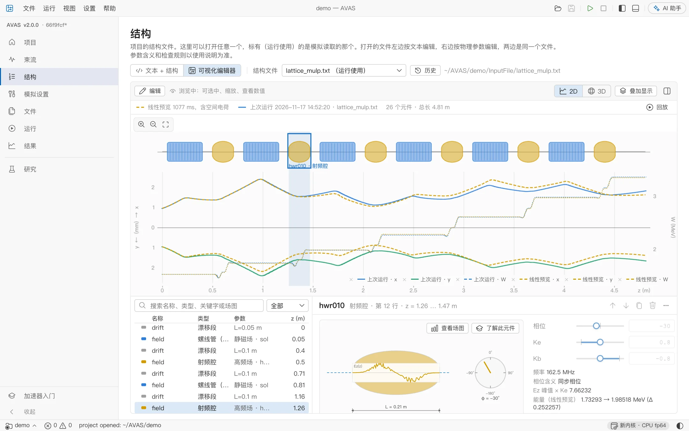
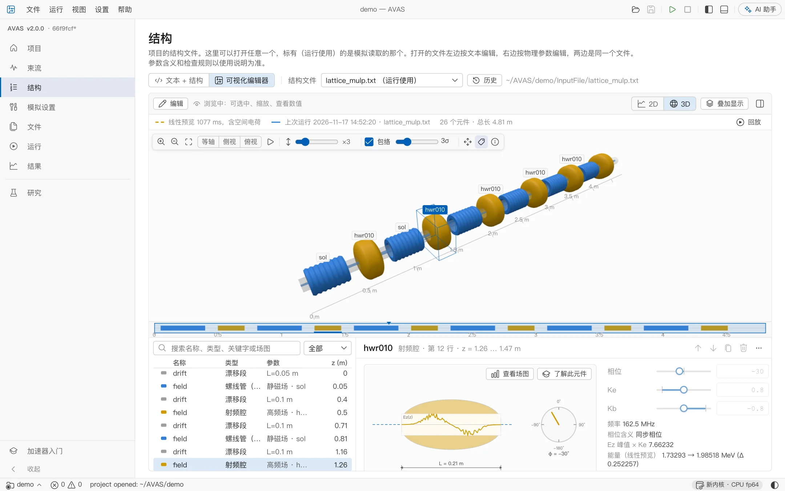
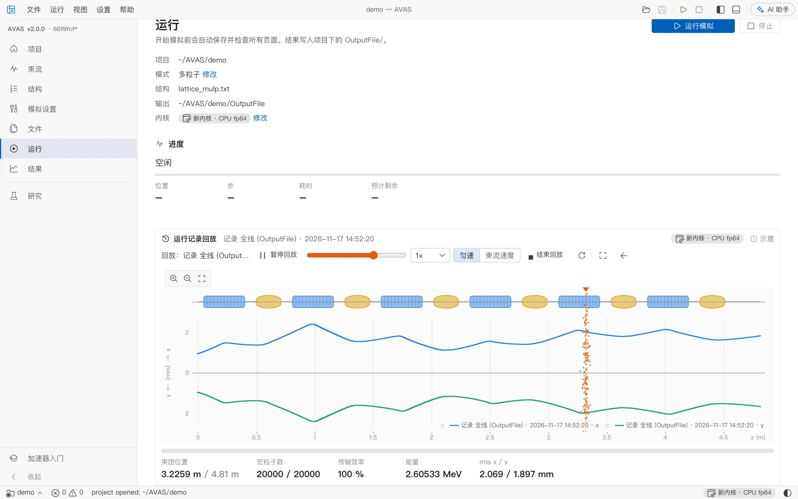
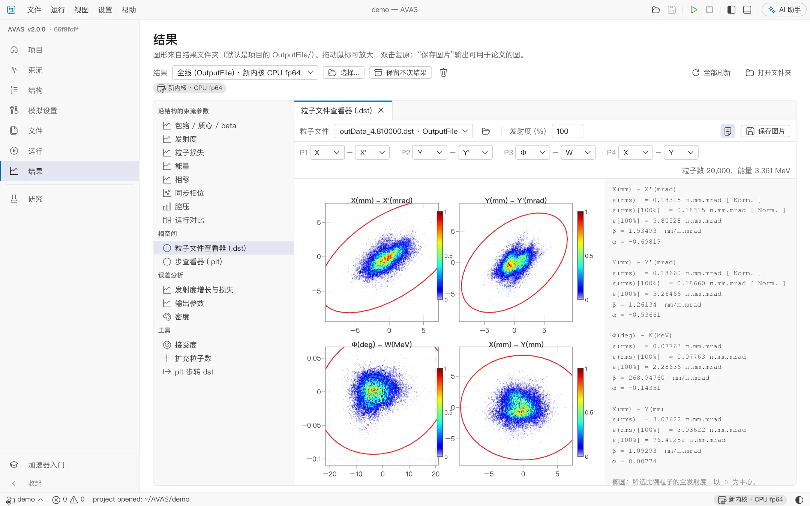
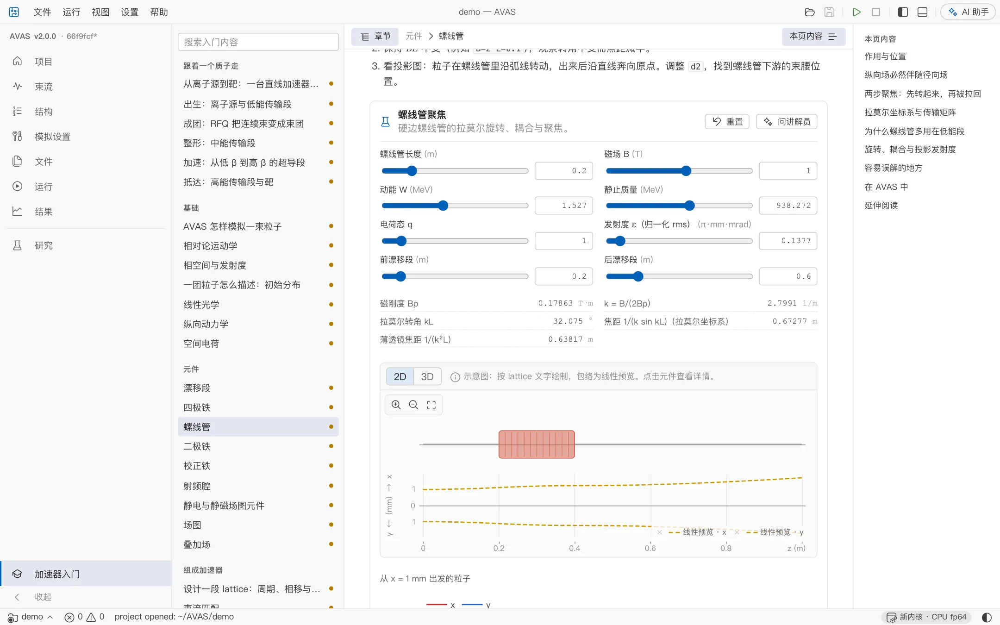

<div align="center">


# AVAS

**Advanced Virtual Accelerator Software：直线加速器束流动力学模拟软件**

[](https://github.com/lycself/AVAS_XMU/releases/latest)
[](https://github.com/lycself/AVAS_XMU/actions/workflows/ci.yml)


[-b31b1b)](https://doi.org/10.1103/PhysRevAccelBeams.28.044602)

中文 · [English](README.en.md)

</div>

AVAS 模拟直线加速器中的多粒子束流：射频腔与螺线管等场图元件、四极铁与二极铁等硬边元件、三种空间电荷算法、误差研究和损失边界。它带有桌面与浏览器图形界面、命令行和 Python 研究接口，界面支持中文和英文。

<p align="center"></p>

- **一个内核，三种设备**：重建的新内核在 CPU、NVIDIA GPU（CUDA）和 Mac GPU（Metal）上计算，GPU 只需要显卡驱动；“复现 AVAS.dll”模式可以逐位得到原内核的结果。
- **所见即所得的束线编辑**：文本、结构表、二维布局和三维视图共用一份 lattice 和撤销历史，修改参数时实时给出线性包络预览。
- **运行与分析**：实时包络与回放、相空间查看、运行对比、分段运行、误差研究，图片可直接导出用于论文。
- **研究工具**：参数扫描、周期稳定区图谱、响应矩阵与可控性、反馈仿真，以及可在 notebook 中调用的 Python 研究接口。
- **加速器入门**：从离子源到靶的故事线、每种元件的物理与方程、交互实验和引导教程，无需打开项目。
- **AI 助手**：支持 OpenAI 兼容接口和本地模型，读取项目、解释结果、提出修改（经批准后写入），在副本里做扫描与优化。

[下载与快速开始](#下载与快速开始) · [主要功能](#主要功能) · [源码安装](#源码安装) · [命令行与浏览器](#命令行与浏览器) · [更新与常见问题](#更新与常见问题) · [文档与反馈](#文档与反馈)

## 下载与快速开始

在[官方发布页](https://github.com/lycself/AVAS_XMU/releases)选择适合的文件：

| 使用方式 | 下载文件 | 启动方法 |
| --- | --- | --- |
| Windows 安装版（推荐） | `AVAS-版本-setup.exe` | 双击安装，再从快捷方式启动 |
| Windows 便携版 | `avas-windows.zip` | 完整解压，运行 `AVASGui.exe` |
| Linux、macOS、源码运行或开发 | `avas-source.zip`，或克隆仓库 | 按下方“源码安装”配置环境 |

Windows 安装版和便携版无需 Python、Git 或 GitHub 账户。请保留便携包的完整目录，不能只复制 exe。GitHub 自动附带的 **Source code** 是源码；`update.json` 是供程序读取的元数据，无需手动下载。桌面界面需要 Microsoft Edge WebView2，缺少时会提示安装；安装器支持中文和英文，首次启动沿用安装器语言。

首次使用：

1. 打开 AVAS，新建项目或打开已有项目；源码仓库提供 [hwr010 示例](examples/hwr010)。
2. 在“束流”“结构”“模拟设置”页检查输入；需要切换运行文件时，在结构页点击“设为运行结构”。
3. 点击“运行”，在运行页查看进度和实时包络，在结果页分析输出。
4. 需要留下结果时点击“保留本次结果”；下次完整运行会覆盖 `OutputFile/`。

详细步骤可在 **帮助 → 使用说明** 中离线查看，或阅读[操作指南](frontend/src/help/manual.zh.md)。

### 在 CPU 和 GPU 上计算

| 平台 | 安装 | CPU | GPU |
| --- | --- | --- | --- |
| Windows 10／11 x64 | 安装包或便携包，两个内核都已包含 | ✅ 新内核、原内核 | NVIDIA（CUDA），只需显卡驱动 ≥ 527.41 |
| Linux x86-64（glibc ≥ 2.17，含 CentOS 7） | 源码安装，没有安装包 | ✅ 新内核、原内核 | NVIDIA（CUDA），只需驱动 ≥ 525.60.13 |
| macOS（Apple 芯片） | 源码安装，只有新内核 | ✅ 新内核 | Mac GPU（Metal，只有 fp32） |

**不需要安装 CUDA**：新内核静态链接了 CUDA 12.4 运行库，装的是哪个版本的 CUDA 工具包都没有关系，集群上也不需要 `module load cuda`。预编译库支持的 NVIDIA 架构：

| 架构 | 典型显卡 |
| --- | --- |
| Pascal sm_61 | GTX 10 系列、Tesla P40、P4 |
| Turing sm_75 | T4、RTX 20 系列、GTX 16 系列 |
| Ampere sm_80／86 | A100、A30；RTX 30 系列、A40、A10、RTX A6000 |
| Ada sm_89 | L40S、L4、RTX 40 系列 |
| Hopper sm_90 | H100、H200 |

更新的架构由驱动即时编译库中附带的 compute_90 中间代码（尚未实测）。**P100（sm_60）、V100（sm_70）及更老的卡不能用预编译库的 GPU**，需要时可用 CMake 和 CUDA 12.x 重新编译（见 [CONTRIBUTING.md](CONTRIBUTING.md)）；ARM 架构的 Linux 不支持。

在界面中用 **模拟设置 → 计算内核** 选择设备，命令行用 `--device`：

```bash
avas run --input 项目/InputFile --output 项目/Results_001 --engine new --device cuda --precision auto --gpus all
```

`--device` 可为 `auto`／`cpu`／`cuda`／`metal`。“自动”在有 NVIDIA 卡且粒子数不少于 1000 时用 CUDA，在 Mac 上有空间电荷且粒子数至少 6 万时用 Metal，其余用 CPU；精度“自动”在 CPU 和 fp64 全速的卡（A100、H100）上用 fp64，其他 GPU 用 fp32。明确选择的设备不可用时运行前直接报错，不会悄悄改用 CPU。`avas info` 显示本机找到的内核库、GPU 与驱动，以及“自动”会用什么。

## 主要功能

侧栏按工作流排列：项目、束流、结构、模拟设置、文件、运行、结果；其下是研究页，加速器入门固定在底部（`Ctrl+1`…`Ctrl+9` 按此顺序切换）。界面支持浅色／深色主题、界面缩放和鼠标／触控板操作。

| 页面 | 用途 |
| --- | --- |
| 项目 Project | 新建、打开项目，查看输入与上次运行摘要 |
| 束流 Beam | 配置粒子、能量、分布、Twiss 参数；单粒子初始偏移；读取 `.dst` 粒子文件并显示其粒子分布；二次粒子开关与 SeParticle.txt |
| 结构 Lattice | 文本与参数联动编辑、关键字检查、二维布局与三维束线视图 |
| 模拟设置 Simulation settings | 选择计算内核、设备与精度；配置模拟类型、步长、空间电荷、纵向周期边界、多线程与误差研究；编辑损失边界 boundary.txt |
| 文件 Files | InputFile 的文件浏览器：原始文本、场图曲线与切片、粒子文件，导入、复制、重命名 |
| 运行 Run | 启动、暂停、停止模拟，查看实时包络、运行记录与回放 |
| 结果 Results | 分析包络、发射度、损失、能量、相空间与单粒子轨迹，对比运行并导出 PNG／PDF／SVG |
| 研究 Study | 参数扫描（线性模型或内核，一维／二维热图）、周期稳定区图谱、响应矩阵与可控性、反馈仿真 |
| 入门 Primer | 加速器原理、各元件的物理与参数、交互实验和引导教程，无需打开项目 |

<table>
<tr>
<td width="50%"><br><sub><b>三维束线</b>：元件按真实尺寸排布，可叠加按 rms 包络绘制的示意束团</sub></td>
<td width="50%"><br><sub><b>运行与回放</b>：实时包络，历史记录逐步回放，显示传输效率与能量</sub></td>
</tr>
<tr>
<td width="50%"><br><sub><b>结果分析</b>：相空间密度图与 rms 参数，图片可导出用于论文</sub></td>
<td width="50%"><br><sub><b>加速器入门</b>：章节中的交互实验与束线示意，拖动参数即时计算</sub></td>
</tr>
</table>

### 计算内核

AVAS 有两个计算内核。**新内核**是在原内核源码丢失后逆向重建的，是所有平台的默认内核：可在 CPU、NVIDIA GPU 和 Mac GPU 上计算，支持 `scmethod PICNIC` 和按 cell 计算的 `rfq` 元件（只在 CPU 上计算，原内核不能运行它，所以尚未与参考结果核对），并修正了原内核的若干缺陷，结果会与以前略有不同。**原内核**（`AVAS.dll`／`libAVAS.so` 2026-04-02 版，只有 Windows 与 Linux x86-64）仍可选择，将在以后的版本中移除；新内核的“复现 AVAS.dll”模式可以逐位得到原内核的结果。

在 **模拟设置 → 计算内核** 中按项目选择内核、设备和精度，保存在 `ini.ini` 的 `[engine]` 段；菜单 **设置 → 默认计算内核** 一次改变所有没有单独选择的项目。一次运行用哪个内核按 命令行 > 环境变量 > 项目 `ini.ini` > 默认计算内核 > 内置默认 决定，命令行 `avas run`、研究页和 AI 助手的试算同样遵守。运行页、状态栏、结果页与运行对比标注每次运行实际使用的内核和设备（如“新内核 · Metal fp32”）。界面中只有新内核默认模式读取的输入标注“仅新内核”，项目选用原内核或兼容模式时改为“当前内核会忽略”。

<details>
<summary>与原内核的差别和注意事项（展开）</summary>

- 原内核与兼容模式在 `randomseed` 非 0 时生成的初始分布中 x 与相位完全相关，模拟设置页和研究页（研究运行固定种子 12345）会提示；新内核默认模式没有这个问题。
- 没有内核读取 `scanphase` 与 scanData.txt：模拟设置页不再提供相位扫描，文件里已有的 `scanphase` 行会注明并在保存时删去。
- 二次粒子：新内核默认模式在 beam.txt 没写 `readparticledistribution` 时读取 SeParticle.txt，原内核与兼容模式只读 beam.txt 写明的文件；二次粒子运行没有包络，结果在 `outData_*.txt` 与 `SeSynParticle.txt`，分段运行不支持二次粒子。
- Linux 上 `ini.ini` 的 `[input] device = gpu`（libPIC.so）已弃用，请改用新内核的 NVIDIA GPU（`--engine new --device cuda`）。
- 选用原内核或兼容模式时，运行前会拦下或提醒：boundary.txt 含 superpose 块或矩形管（3）、椭圆管（4）时拒绝运行（原内核会异常退出）；位于叠加块开头的射频腔（原内核里没有场）、`initpos`／`initmom`、`lpboundary` V2、带名称的输出面、Ke = 0 的射频场会提醒被忽略或处理不同。Linux 上运行副本中的 boundary.txt 自动改为 LF 换行（libAVAS.so 遇到 Windows 换行会崩溃）。
- 新内核默认模式中，写在四极铁、螺线管、二极铁、边缘场前或第一个元件前的 `spacechargecomp` 也从该处生效；superposeout 块内被反射、退回块入口之前的粒子判为丢失，运行正常结束。
- 新内核默认模式加入了原作者 2026-07-22 版原内核的新功能（兼容模式与随附的原内核仍按 2026-04-02 版）：读入 `.dst` 时同步粒子能量取 beam.txt 的 `kneticenergy`（写负值取文件平均能量，相差超过 1 % 时提示）；单粒子偏移的 `initpos`（mm）与 `initmom`（mrad、1e-3）；单粒子运行另写 SingleParticlePlane.txt；`outputplane d NAME` 写成 `NAME_<z>.dst`，间距小于束团长度的输出面可以同时记录；boundary.txt 的矩形管、椭圆管与 superpose 复合段，薄准直器的碰撞检查，CollisionData.txt 多一列 superposeout 块数；Ke = 0 的射频 field 行按漂移段处理；`lpboundary 0 1` 纵向周期空间电荷盒（束流静止系一个射频周期 γβλ，支持 GPU）。
- 束流页粒子数填 1 即为单粒子模式，可设置初始偏移 x、y、z（mm）、x′、y′（mrad）与 δ（1e-3），保存时统一写成各内核都能读取的 `displacepos`／`displacedpos`；结果页对单粒子运行列出“单粒子在各输出面”。

</details>

### 结构编辑与文件历史

文本、结构和可视化编辑共用同一份内容与撤销历史。可视化编辑器默认处于浏览状态，点击“编辑”后可拖放元件、调整参数；完成时可保存、放弃本次编辑或继续编辑。二维布局支持叠加元件：拖到已有非漂移元件上可对齐入口叠加，重叠元件上下分层显示；二维／三维右键菜单提供叠加、复制和删除。仅根据场文件名识别的类型标注“推测”。

结构页的文件选择框用于打开文件，运行中仍可切换查看；“设为运行结构”单独指定模拟使用的文件。文件页与结构页提供保存历史和差异对比，恢复先进入编辑器，可撤销，保存后才写入文件。历史存于项目 `.avas_history/`，支持不超过 2 MB 的 lattice、`beam.txt` 和 `input.txt`。

### 场分布、实时显示与结果

元件视图的“查看场图／查看场分布”打开浮动窗口，可查看横截面、纵切面、热力图与方向箭头。场文件显示实际数据，解析模型显示按参数计算的硬边界示意场。横截面统一从下游往上游看，束流朝屏幕外（⊙）。运行页支持本次和历史运行的回放，结构页可回放上次运行；束团、粒子云和线性包络预览用于示意与快速评估，最终结果以内核计算为准。

完整运行与误差研究在输出目录的 `inputs/` 快照上运行；分段结果写入 `Segments/`，研究页的内核运行写入 `Research/gui/`（与 Python 研究接口共用）。结构页“周期分析”给出周期的相移、匹配束和稳定性；结果页可叠加按该次运行输入计算的线性模型。完整运行、误差研究和分段运行期间（含暂停），输入文件只读。已保留的完整运行存入 `Runs/`，可在结果页与其他运行对比。

### 加速器入门

侧栏最后一页（或“帮助 → 加速器入门”）系统介绍直线加速器：从“跟着一个质子走”的故事线开始，依次讲离子源、RFQ、中能传输段、超导加速段和高能传输段；再讲相对论运动学、相空间与线性光学、纵向动力学、空间电荷，每种 AVAS 元件的原理、场与方程、传输矩阵和参数。各章先讲物理图像和推导，再在“在 AVAS 中”参考小节给出关键字和约定。章节中的交互实验和 2D／3D 束线示意使用与线性包络预览相同的代码，属于近似模型；引导教程用示例场图逐步搭出一段超导加速段，可随时用多粒子内核运行对比，并另存为新项目。内容由 AI 撰写，每章标注“AI 撰写，待审核”；“问讲解员”把当前章节或实验结果交给 AI 助手讲解。

### AI 助手

工具栏右侧或 `Ctrl+Shift+A` 打开助手。它支持 OpenAI 兼容接口和本地模型，可读取项目、解释结果、查询本机的计算内核与 GPU、检索使用说明、提出参数修改，并在副本中执行扫描与优化。每项文件修改以提案展示，经批准后应用（也可在单个对话中开启自动应用）；写入前备份到 `.avas_ai/backups/`，试算在 `.avas_ai/runs/` 中进行，不改项目的 `InputFile/` 与 `OutputFile/`。API 密钥在 Windows 上保存在凭据管理器中，其他平台保存在用户数据目录的 `ai_secrets.json`。

## 源码安装

使用 **64 位 Python 3.11 或更高版本**（开发和测试使用 3.11，3.12／3.13 支持），请手动创建独立的 `.venv`，避免直接在 Anaconda base 中安装。新内核的预编译库已在 `avas/engine/new/` 中，普通使用不需要编译器；前端编译结果也已随仓库提供，不需要 Node.js。

**Windows**（仓库根目录的 PowerShell）：

```powershell
python -m venv .venv
.\.venv\Scripts\python.exe -m pip install --upgrade pip
.\.venv\Scripts\python.exe -m pip install -e .
.\.venv\Scripts\python.exe -m avas gui
```

**Linux**（服务器与集群，glibc ≥ 2.17）：

```bash
python3.11 -m venv .venv
.venv/bin/python -m pip install -e .
source .venv/bin/activate
avas info
```

不能上外网的集群可用 Miniforge 把 Python 3.11 装在家目录，依赖在别处下载后离线安装；不需要 Docker、管理员权限或 CUDA 模块。多卡用 `--gpus all`，Slurm 作业示例见 [examples/cluster/avas_slurm.sh](examples/cluster/avas_slurm.sh)，服务器上的图形界面用 `avas serve` 加 SSH 端口转发。

**macOS（Apple 芯片）**：命令行、`avas serve` 与 `avas gui` 均可使用，只有新内核，在 CPU 或 Metal 上计算。仓库没有预编译的 `libavas_engine.dylib` 时，需要 Xcode 命令行工具与 CMake 自行构建，必须用 Apple clang（若环境设置了 `CC`／`CXX`，例如 conda，先取消）：

```bash
python3.11 -m venv .venv
.venv/bin/python -m pip install -e .
# 仅当 avas/engine/new/ 中没有 libavas_engine.dylib 时：
env -u CC -u CXX cmake -S engine -B engine/build -DCMAKE_BUILD_TYPE=Release
cmake --build engine/build -j
.venv/bin/python -m avas gui
```

想直接使用 `avas` 命令时先激活环境（PowerShell 执行 `.\.venv\Scripts\Activate.ps1`，CMD 使用 `.venv\Scripts\activate.bat`，Linux／macOS 执行 `source .venv/bin/activate`）。AVAS 依次在环境变量 `AVAS_ENGINE_LIB`、`avas/engine/new/` 与 `engine/build/` 中寻找新内核库。仓库中的 `run_avas.py`／`run_avas.cmd` 默认使用本地 `.venv`，可用 `AVAS_NO_VENV=1` 关闭。开发依赖、构建、调试和打包见 [CONTRIBUTING.md](CONTRIBUTING.md)。

## 命令行与浏览器

`--input` 可指向输入目录或包含 `InputFile/` 的项目目录，`--output` 可指向任意输出目录。结构文件默认读取 `ini.ini` 的 `[lattice] source`，未指定时使用 `lattice_mulp.txt`；`--lattice` 可临时覆盖。

```bash
# 运行模拟；误差研究可使用 --mode stat、dyn 或 stat_dyn
avas run --input proj/InputFile --output proj/Results_001
avas run --input proj/InputFile --output proj/Results_002 --lattice lattice_init.txt

# 选择内核与设备：--device auto|cpu|cuda|metal，--precision auto|fp64|fp32，--gpus all|0,1，--threads N
avas run --input proj/InputFile --output proj/Results_003 --engine new --device cuda --precision fp32

# 绘图；不加 --save 时弹出窗口
avas plot emittance_x --output proj/Results_001 --save emit_x.png
avas plot phase --dst proj/Results_001/outData_0.210000.dst --plane x-x1 --plane phi-w

# 参数扫描；结果写入项目 Scans/ 下的 scan.json、scan.csv 及各次输出目录
avas scan --input proj/InputFile --target Q1 --param G --values 10,12,14

# 桌面、浏览器、版本与安装自检
avas gui --lang zh_CN
avas serve --open
avas info
avas doctor
```

`avas run --help`、`avas plot --help` 和 `avas scan --help` 提供完整选项。内核选项的优先级为：命令行（`--engine --device --precision --gpus --threads --compat`）> 环境变量（`AVAS_ENGINE`、`AVAS_ENGINE_DEVICE` 等）> 项目 `ini.ini` 的 `[engine]` > 默认值；`--compat dll` 让新内核逐位复现 AVAS.dll（只能在 CPU 上）。运行输入快照保存在 `<输出>/inputs/`，`avas_run.json` 记录其位置和实际使用的内核、设备、精度；场图从原目录读取。绘图默认从运行记录查找输入目录，也可用 `--input` 指定。

**浏览器模式**：`avas serve --open` 启动服务并打开带访问令牌的地址，页面与桌面版共用功能；文件选择使用页面内对话框，文件导出使用下载。默认只监听本机；使用 `--host 0.0.0.0` 开放局域网时，请仅用于可信网络，目前没有用户管理和工作区隔离。关闭标签页不等于停止后端服务。

**Python 研究接口**：在 notebook 或脚本中可直接调用线性模型（`avas.model`）、周期与控制分析（`avas.dynamics`）和研究接口（`avas.research`）。研究接口把项目的“变体”（lattice 参数、beam.txt／input.txt 关键字、种子、粒子数）交给线性模型或内核运行，内核在子进程中运行，结果按输入指纹缓存在 `<项目>/Research/<研究名>/`，可批量、并行、续跑，并可做多维扫描、拉丁超立方采样、线性模型与内核对比、多种子统计和数据导出；不会改动项目的输入和 OutputFile。示例见 [examples/research/](examples/research/)。

## 更新与常见问题

<details>
<summary><b>如何更新？</b></summary>

Windows 安装器在欢迎页点击“下一步”时检查最新版，可下载并校验新版安装器，保留语言与安装范围。失败时显示原因，可重试、选择“忽略”安装内置版本，或退出；`/NOCHECKUPDATE` 和静默安装使用内置版本。只有包含检查功能的新安装器支持此流程。

已安装的 AVAS 会在启动后检查官方更新，结果缓存 6 小时；**帮助 → 检查更新** 可立即重查。确认“更新并重启”后下载并准备安装，完成后自动重开 AVAS。“稍后”只收起本次会话提醒，“忽略此版本”保存对该提交的忽略记录，均可从帮助菜单重新查看。

下载与准备阶段可取消，关闭更新面板只收起显示；进入安装阶段后不能取消。网络中断后可重试并复用已下载内容。运行、暂停、扫描及 AI 试算期间不能安装，更新准备期间也不能开始新模拟。安装时请等待自动重启，避免手动重复启动。

更新保留项目、结果、个人设置和 `.venv`。macOS 上只支持 Git 方式的自动更新（源码安装）。Git 自动更新要求官方 origin、main 分支、工作区干净且可快进；源码包遇到文件修改或覆盖冲突时停止。源码更新需从安装目录的 `.venv` 启动。浏览器模式需在后端机器更新并重启服务。

</details>

<details>
<summary><b>更新失败或旧版本无法升级？</b></summary>

先查看错误原因；切换系统代理后可直接重新检查，无需重启。日志、结果与备份位于 `%LOCALAPPDATA%\AVAS\updates\update-*\`。若旧版报告 `Update metadata is too large`，或更新器本身无法升级，请关闭 AVAS，从官方发布页手动安装新 setup；便携版完整解压到新目录。

请保留 `.avas-install.json`／`.avas-source.json` 版本标记。安装中断时保留备份与 `journal.json`，避免手动混合不同版本文件。源码更新的依赖安装失败时，可在安装目录执行：

```powershell
.\.venv\Scripts\python.exe -m pip install -e .
.\.venv\Scripts\python.exe -m pip check
```

</details>

<details>
<summary><b>GPU 没有被使用？</b></summary>

运行 `avas info` 查看找到的内核库、GPU、驱动和“自动”的选择。常见原因：驱动低于上表要求；显卡是 P100、V100 或更老的型号；粒子数少于 1000（这时 CPU 更快，“自动”选 CPU 并在日志中写明原因）；Mac 上没有空间电荷或粒子数少于 6 万。明确选择 GPU 而本机不能用时，运行前会给出具体原因。

</details>

<details>
<summary><b>在哪里找设置、日志和版本信息？</b></summary>

Windows 上个人设置位于 `%LOCALAPPDATA%\AVAS\gui.json`，程序日志位于 `%LOCALAPPDATA%\AVAS\logs`。**帮助 → 关于 AVAS → 复制版本信息** 提供版本、提交、内核与构建信息，便于反馈问题。界面快捷键见帮助菜单；`Ctrl+S` 保存，`F5` 运行，`Shift+F5` 停止。

</details>

## 文档与反馈

| 资料 | 内容 |
| --- | --- |
| [操作指南](frontend/src/help/manual.zh.md) | 项目设置、编辑、运行、扫描与分析；计算内核、各平台的 CPU／GPU、Linux 服务器 |
| [案例教程](frontend/src/help/cases.zh.md) | 示例步骤、原始资料与验证状态 |
| [参数与文件参考](frontend/src/help/reference.zh.md) | 输入文件、关键字与物理参考入口 |
| [原始物理手册](docs/使用说明20260427.docx) | 物理说明原文；旧案例是否可运行以教程验证状态为准 |
| [新内核](engine/README.md) · [逆向规格](docs/engine/README.md) | 新内核的构建与 GPU 后端，原内核的逆向规格与对齐记录 |
| [开发指南](CONTRIBUTING.md) · [开发约定](AGENTS.md) | 环境、调试、构建、测试与设计规则（AI 编程助手先读 AGENTS.md） |
| [发布变更记录](docs/changes/) · [早期更新记录](docs/CHANGELOG.md) | 各次改动说明 |

界面内的使用说明提供“操作指南／案例教程／参数与文件参考”，支持搜索和浮动阅读。维护者：Yuchen Lin，反馈邮箱：[yuchenlin@stu.xmu.edu.cn](mailto:yuchenlin@stu.xmu.edu.cn)。

### 引用

科研工作使用 AVAS 时，请引用：

> C. Jin, Z.-J. Wang, X. Qi, Y. He, K. Li, et al., *Advanced virtual accelerator software: A linear accelerator simulation code*, Phys. Rev. Accel. Beams **28**, 044602 (2025). [DOI](https://doi.org/10.1103/PhysRevAccelBeams.28.044602)

版权归中国科学院近代物理研究所，许可条款见 [LICENSE](LICENSE)（科研用途）。
